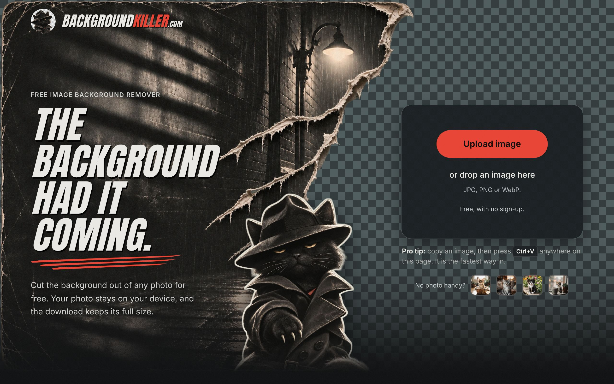
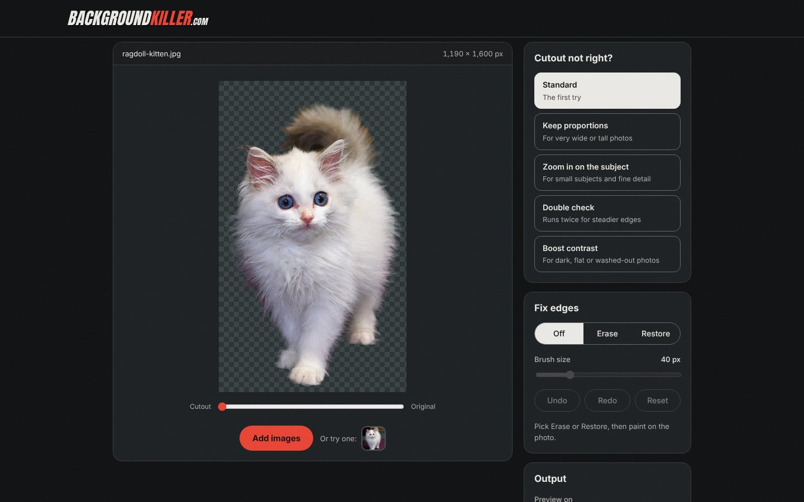

# Background Killer

A free background remover that runs entirely in your browser. There is no server and nothing is uploaded: the cutout model runs on your own computer, downloads keep your original resolution, and you can cut out a whole batch of photos at once and take them as a zip. It was built as a free, no sign-up alternative to remove.bg.

**[Use it at backgroundkiller.com](https://backgroundkiller.com)**

## What it does
- **Cuts out the subject** with the ISNet general-use model, in the browser, with no account, watermark or limit.
- **Keeps fine detail.** A refinement step in `public/matte.js` turns the model's coarse mask into a real alpha matte at working resolution, so fur, hair and whiskers survive. It snaps the mask to the photo's edges with a guided filter, solves each uncertain pixel by unmixing it into subject and background colour, cleans the colour at the rim so the old background leaves no halo, and drops faint smears that run off the edge of the photo.
- **Previews on a transparent checkerboard** by default. Switch the preview to a dark mat, and choose a transparent, white, black or custom colour background for the download.
- **Full-size downloads** as PNG or WebP, matching your original pixels, with an option to trim to the subject. Copy the result to the clipboard in one click.
- **Batch mode.** Drop in 20 or more photos, keep adding while others are still cutting, then download a zip or save straight to a folder. It can notify you when the batch finishes.
- **Fixes for tricky photos.** Four other ways to run the model (keep proportions, zoom in on the subject, double check, boost contrast), an edge slider, and Erase and Restore brushes with undo and redo.
- **Works on phones.** The layout is built for narrow screens as well as desktops.

## How it works
- `public/` is the whole site. Plain HTML, CSS and JavaScript, no build step.
- The cutout model (ISNet general-use, Apache-2.0, 47 MB, with 8-bit per-channel weights and full-precision maths) lives in `public/model/` as four chunks named `.wasm` so any static host serves them. The browser reassembles them and caches the result with the Cache API.
- ONNX Runtime Web 1.20.1 (`public/ort/`) runs the model in a Web Worker (`worker.js`, `engine.js`).
- `public/matte.js` does the edge refinement and runs on the main thread after the model returns its mask.
- Fonts (Anton, Inter), JSZip and the runtime are all self-hosted, so the page makes no third-party requests. Its only other request goes to our own visit counter at stats.pigrosoft.com (cookieless, nothing stored about the visitor, nothing from your photos).

## Licence
The code is MIT licensed, see `LICENSE`. The licence does not cover the name, logo, Claw artwork, or other images in `public/assets/`. The sample photo of a ragdoll kitten is by Arjunmz, [CC BY 4.0](https://creativecommons.org/licenses/by/4.0/), from [Wikimedia Commons](https://commons.wikimedia.org/wiki/File:Ragdoll_kitten_on_the_prowl_2017_(cropped_2022).jpg). The model, runtime, JSZip and fonts keep their own licences in `public/licenses/`.

If you fork this and publish your own copy, use your own name and artwork, and replace the imprint, privacy and terms pages with your own details.

## Contributing
Bug reports and pull requests are welcome, and the site should stay free of servers, uploads and third-party requests (the one small request to our own counter is the exception). For anything else, write to support@pigrosoft.com.

## Version
Edit `public/version.js` (version and date, shown in every footer), then add an entry to `CHANGELOG.md` and copy it to `public/CHANGELOG.txt`.

## Pages
The guide, legal and about pages, the footer, the FAQ and the sitemap are generated by `python3 scripts/build_pages.py`. The generated HTML is committed, so deploying needs no build.

## Deploy (Cloudflare Workers with static assets)
`wrangler.jsonc` points Cloudflare at `public/`. Connect this repo in the Cloudflare dashboard (Workers & Pages, Create, Import a repository), leave the build command empty and keep the default deploy command `npx wrangler deploy`. Every push to the main branch redeploys.

Do not add COOP/COEP headers to get multi-threaded WASM: they block third-party embeds.

## Local preview
`cd public && python3 -m http.server 8000`
